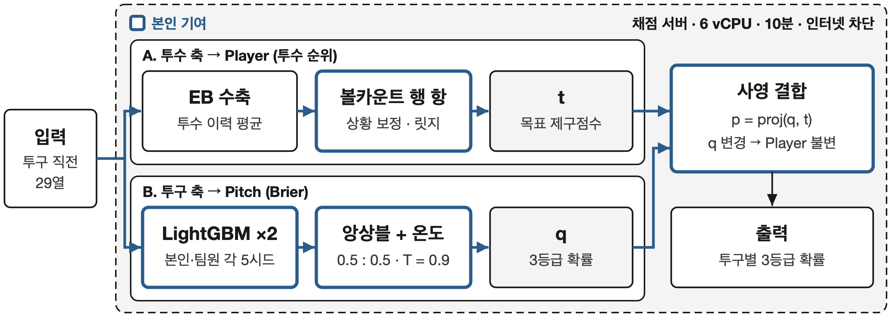
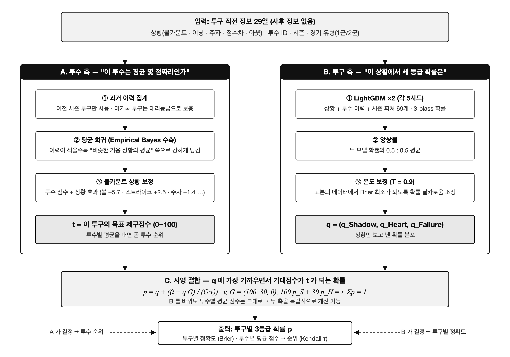

# KBO 투구 제구등급 예측 — LG Aimers 9기 해커톤

> 투구 직전 정보 29열만으로 KBO 투구의 제구 등급(Shadow / Heart / Failure) 확률을 예측하는 24시간 오프라인 해커톤 (2026-09-19 ~ 09-20, DACON)
> 팀 miniL 4인 · **최종 Score 70.3140 (팀 최고)** · Pitch 70.1038 / Player 70.8044 · 주최 베이스라인 대비 **+1.79**


<sub>파란 테두리 = 본인 기여</sub>

## TL;DR

- **문제를 다시 정의했다.** 평가식을 분해해 보니 Pitch(Brier)는 포화 상태였고, 점수 차이는 **투수 순위(Kendall τ)**에서 났다. 그래서 이 과제를 "Brier를 잃지 않으면서 투수 순위를 맞히는 문제"로 바꿔서 풀었다.
- **구조를 설계했다.** 확률 q(Pitch 담당)와 투수 목표점수 t(Player 담당)를 **사영(projection)으로 분리**했다. q를 바꿔도 Player가 **비트 단위로 불변**이라는 걸 수학적으로 보장하는 구조이고, 이것이 팀 전체의 기본 구조가 됐다.
- **내 최대 단일 기여는 볼카운트 행 항이다.** Player +1.08로 당시 팀 최고를 기록했고, 팀 표준 부품으로 채택됐다.
- **최종 조립도 내가 했다.** Player를 그대로 둔 채 q만 앙상블하고 온도 보정을 적용했다. 마감 18분 전에 하방 위험 없이 **팀 최고점**을 제출했다.
- **검증 규율을 세웠다.** 오프라인 폴드는 Player 부호를 한 번도 맞추지 못했다(0/7). 그래서 LB 탐침 규칙을 세우고 게이트를 자동화해 실패를 각 1회 제출로 막았다.

---

## 1. 과제와 제약

| 항목 | 내용 |
|---|---|
| 입력 | 투구 직전 29열 — 볼카운트·이닝·아웃·주자·점수차·승리기대·LI·투수/타자 ID·좌우·팀·시즌·경기유형(1군 R / 2군 F) |
| 출력 | 투구별 3등급 확률 (Shadow / Heart / Failure) |
| 데이터 | 학습 2019~2024 1,474,868행 (라벨 결측 17%) · 평가 2025 218,992행 (비공개) · 사후정보(투구 위치·구종·Trackman)는 학습에만 있음 |
| 지표 | `Score = 0.7·Pitch + 0.3·Player`<br>Pitch = 100·(1 − Brier/2)<br>Player = 50·(1 + τ_b), 투수별 평균 예측점수 `mean(100·p_S + 30·p_H)`와 실제값의 Kendall τ_b (50구 이상 투수 321명) |
| 제약 | 제출물 = **코드 zip**을 채점 서버(6 vCPU · 10분 · 인터넷 차단 · py3.11 / numpy 1.26.4)에서 실행<br>**평가 행끼리 서로 참조(투수별 집계·순위·분포 보정) 금지** — 모든 예측은 행 독립이어야 함 |

## 2. 핵심 통찰 — 점수는 어디서 나는가

| 관찰 | 근거 | 결정 |
|---|---|---|
| **Pitch는 포화, 전장은 Player** | Pitch: 상수 prior 69.71 → LightGBM 70.0, 상위권 70.18~70.25 (폭 0.5)<br>Player: τ 0 → 0.3이면 Score +4.5 | 과제를 "Brier를 지키면서 순위를 맞히는 문제"로 재정의 |
| **상황은 실력과 역상관** | 0-2 카운트 평균 23.3 vs 0-0 29.1 (좋은 투수가 유리한 카운트를 만든다)<br>상황만으로 순위를 매기면 τ −0.23 | GBDT 단독은 투수 순위를 상황 순위로 덮어씀 → 두 축 분리 필요 |
| **2023 퓨처스(F) 체제변화** | F 경기 반대투구 기록률 2022 4.9% → 2023 30% (같은 투수 70명 기준)<br>`season` 열 하나로 τ 0.20 → 0.32 (+1.8) | season 열로 체제를 인식. 2025는 전 구장 ABS 첫 해라 오프라인에서 관측 불가 |
| **신호대잡음 1:1** | 투수 간 참 실력 sd 1.76 ≈ 투구 523개 평균의 표준오차 1.60 | 완벽한 실력을 알아도 τ 상한은 0.59~0.65 → 강한 수축이 정답 |
| **평가셋의 정체** | 218,992 ≈ 2024 라벨행 218,836 → 2025 라벨 확정 투구만 평가 | 321명 중 신인 60명(19%)과 이력 1,000구 미만 154명이 병목 |

## 3. 아키텍처 — q / t 분리 (anchor projection)

```
q = LightGBM 3-class 확률  (상황 + 투수/타자 EB + 이력 + Trackman 프로필 62피처, 5시드)   → Pitch 담당
t = 투수 목표 제구점수     (EB 수축 이력 + 볼카운트·F·좌우·팀 행 항 + 직교 오프셋)          → Player 담당

p = q + (t − q·G) / (G·v) · v      G = (100, 30, 0)
    # 제약 100·p_S + 30·p_H = t,  Σp = 1  에서 q 와 L2 거리가 가장 가까운 해
```

- 사영을 거치면 행의 기대점수가 **정확히 t**가 된다. 그래서 `Player = τ(t)`가 성립한다.
- 따라서 **q를 바꿔도 Player는 비트 단위로 불변**이다. LB에서 3번, 10자리까지 동일한 값으로 확인했다.
- 한 번의 실험은 한 축만 바꾼다. Player 후보는 t 쪽만, Pitch 후보는 t를 고정하고 q만 바꾼다.



## 4. 내 기여와 결과

| 제출 | 결정 | Score | Pitch | Player | 효과 |
|---|---|---|---|---|---|
| 베이스라인 | 주최 RandomForest + 투수 EB | 68.527 | 70.115 | 64.595 | 출발점 |
| d4 | LightGBM 단독 (69피처 · 5시드) | 67.198 | **70.206** | 60.179 | Pitch는 최고급, Player 붕괴 → 진단 |
| d5 | **q/t anchor 분리 구조** 제안 | 68.627 | 70.166 | 65.036 | **Player +4.9** · 팀 기본 구조가 됨 |
| d20 | 팀원 목표값 t + 내 q **하이브리드** | 69.603 | 70.162 | 68.299 | Player 비트 동일 · Pitch +0.044 · 팀 결합 표준이 됨 |
| d22 | **볼카운트 행 항** | 69.886 | 70.103 | 69.380 | **Player +1.08** · 당시 팀 최고 · 팀 표준 부품 |
| **dFING2** | **Player 불변 q 앙상블 + 온도 T=0.9** | **70.314** | 70.104 | **70.804** | 하방 위험 없는 Pitch +0.010 · **최종 · 팀 최고** |

내 제출 전체에서 Pitch는 70.09~70.21(폭 0.12) 안에 머물렀고, Player는 60.2에서 70.8(폭 10.6)까지 움직였다. 처음 진단대로 **점수는 Player에서 났다.**

### 주요 설계 결정 (ADR)

1. **GBDT 단독 → q/t 분리 구조로 전환.** 대안은 (a) 순위 신호를 ε만큼 섞기, (b) 사후에 순위를 재배치하기였다. (a)는 Brier를 잃고, (b)는 평가 행 간 참조 규정에 걸릴 위험이 있었다. 그래서 목표값을 따로 두고 GBDT는 등급 배분만 맡기는 구조를 택했다. Pitch −0.04에 Player +4.9.
2. **볼카운트 행 항.** 투수 목표 t는 투수 평균이라 "이 행이 0-2 카운트인지 3-0인지"를 모른다. 그래서 투수 잔차를 행 상태(볼·스트라이크·주자·득점·아웃)에 릿지 회귀했다.
   - 계수: β_balls −5.74, β_strikes +2.51, β_runners −1.43 …
   - 이력이 적을수록 가중치를 키웠다: w = 2000/(n + 2000)
   - 팀에서 한 번 "지표 조작"으로 폐기된 축이었지만, 규정 문구("자기 행의 열 + 학습으로 만든 상수"만 허용)로 다시 판단해 재추진했다.
   - 세기를 스캔한 결과 scale 1.0에서 +0.54, **0.5에서 +1.08**이었다.
3. **Player 불변 q 앙상블 + 온도 보정.** 마감 4시간 전에는 Player를 건드리는 후보가 LB에서 전부 음수였다. 그래서 사영 구조의 성질을 이용해 **q만** 바꾸는 쪽을 택했다.
   - q = 0.5·(내 모델 5시드) + 0.5·(팀원 모델 5시드)
   - 온도 T는 2023 이전 데이터로 학습한 홀드아웃 모델의 2024 표본외 데이터에서, anchor를 적용한 Brier가 최소가 되도록 적합했다.
   - 게이트 결과: 행 독립 차이 1.1e-16, 투수 평균점수 최대차 7e-15. Player 비트 동일에 Pitch +0.010.

## 5. 검증 설계와 엔지니어링

- **시간 검증**: 2024년을 평가 시즌으로 두고, 2023년 이전 데이터로 학습하는 expanding window 방식을 썼다. 이력 피처는 **LOSO**(leave-one-season-out)로 만들어 인샘플 오염을 없앴다(+1.80).
- **오프라인 검증의 한계를 인정했다.** 폴드와 as-of 패널에서 본 Player 부호가 LB와 **0/7 일치**했다. 원인은 2025 체제(전 구장 ABS)를 관측할 수 없고, 폴드 이득이 "F 비중이 높은 소이력 투수"에 몰려 2025와 거울상이 된다는 데 있었다.
  - 그래서 Pitch는 폴드 결과를 믿고(LB 이관율 0.5~1.0), Player는 **LB 1회 탐침**으로 판정했다.
  - 새 후보는 이미 LB에서 양수였던 가족 안에서만 찾았다.
- **자동 게이트**: 빌드할 때마다 아래 네 가지를 자동으로 확인했다. 통과하지 못하면 제출하지 않았다.
  - (a) 행 독립: 3만 행 부분집합·단일행·역순으로 예측해 비트 비교 (< 1e-10)
  - (b) 확률 합과 범위
  - (c) 2024 라벨행 재현 점수
  - (d) 기준 번들 대비 투수 평균점수의 최대차
- **배포 환경**
  - 채점 서버(numpy 1.26)와 개발 서버(numpy 2)가 달라 pickle을 금지했다. 표는 npz+json, 모델은 LightGBM txt로 저장했다.
  - 제출 전마다 py3.11 venv에서 더미 실행을 강제했다.
  - 추론 32~38초 · 메모리 0.7GB (제한 10분 · 28GB)

## 6. 실패에서 배운 것

| 실험 | 오프라인 | LB | 교훈 |
|---|---|---|---|
| 위치 이력·빗나간 크기 주입 (d6/d7) | 3폴드 3/3 ✓ | Player −0.16 / −0.59 | 폴드는 Player를 맞추지 못한다 |
| skill prior·soft 재라벨 (d10/d14/d36e) | τ +0.06~0.10 | 계열 전체가 음수 | 폴드 이득은 F 소이력 투수를 과대예측한 결과의 거울상이었다 |
| 소이력 직교 prior (d28) | 인샘플 +0.40 | Player −0.48 | 소이력 군을 겨냥한 개입은 어느 방향이든 실패 |
| 타자 질·drift-anchor (d30b) | as-of +1.28 | Player −1.34 | as-of 패널도 Player 예측력이 없다 |
| drift-anchor Pitch 검증 | 홀드아웃 +0.087 | 실제 +0.015 | 미래 데이터로 학습된 부품이 홀드아웃에 섞인 **누수** → 부품마다 학습 창을 확인해야 한다 |

**공통 원리**: "이력을 더 정밀하게 측정하는 것"은 전부 실패했다. **평가 행의 환경(체제·카운트·좌우·팀)을 보정하고 강하게 수축하는 것만 효과가 있었다.** EB 수축 강도도 MSE 최적값보다 3.7배 강한 α 1,800~2,400이 LB 최적이었다.

## 7. 한계와 다음 단계

- **남은 병목**: 2군(F)에 관여한 투수와 소이력 투수 147명(46%)의 군내 순위(τ 0.05, 사실상 무작위)가 남았다. 여기서 τ를 0.25까지 올리면 Player +2이지만, 29열 밖에는 쓸 정보가 없다.
- **다시 한다면**
  1. 첫날부터 투수-시즌 as-of 패널을 만들고, **현재 목표값의 잔차**를 목표로 하는 순위모델을 Player 라인으로 둔다.
  2. Player 불변 Pitch 라인(ADR 3)을 첫 6시간 안에 세팅해 두 라인을 병행한다.
  3. 실험 대장 형식(가설 · 오프라인 · LB · 판정)을 첫 시간부터 강제한다.

## 8. 팀과 역할

| 멤버 | 역할 |
|---|---|
| **dain (본인)** | EDA(체제변화·평가식 분해) · 초기 GBDT 파이프라인 · **q/t 분리 구조 제안** · 하이브리드 결합 · **볼카운트 행 항** · 마지막 날 감사·변형 30여 종·후보정 · **최종 조립** |
| 종민 | 목표값(t) 파이프라인 · LB 판정 규율 |
| seongmin | 대리등급 PGR2 · S 시리즈 실험 |
| celine | Trackman 분석 · r12 주입 |

---

## 레포 구조

```
├── docs/
│   ├── decision_record.md      # 의사결정 기록: 문제 재정의 · ADR 6건 · 결과 · 오차 분석 · 한계
│   ├── technical_report.md     # 상세 기술 보고서: EDA · 아키텍처 · 전체 실험표 · 트러블슈팅 10건 · 재현 가이드
│   ├── eda_summary.md          # EDA 10~25 결과 요약
│   ├── submissions.md          # 내 제출 전체의 구성과 폴드/LB 수치
│   ├── notes/                  # 대회 당일 작성한 전략·조사·작업 기록
│   └── images/                 # 아키텍처 다이어그램 (png/svg)
├── eda/                        # EDA 스크립트 (_common.py: 공식 지표 score(), _feat.py: 피처 빌더)
├── src/                        # 파이프라인 (pipeline.py 표/피처, train.py 학습, usage_fit*.py 볼카운트 항)
│   ├── submit/                 # 초기 단독 제출물 추론 스크립트
│   ├── script_hybrid/          # d20형 하이브리드 추론 스크립트
│   └── l236x/                  # 마지막 날 빌더·진단·후보정 (build_hyb2.py = 최종 조립, fit_calib.py = 온도 적합)
├── final_submission/           # 최종 제출물 dFING2 의 코드 (script.py · dain_feats.py · 설정)
├── results/                    # 볼카운트 β (usage_B.json = d22 계수) · 검증 결과 json
└── logs/                       # 학습·빌드 로그 (문서에 나온 수치의 출처)
```

**Tech**: Python · LightGBM · pandas / NumPy · scikit-learn · SciPy · Empirical Bayes · Kendall τ

## 참고

- **데이터와 모델 가중치는 포함하지 않았다.** 원본 데이터는 대회 규정상 공개할 수 없다. 내 q 모델(LightGBM txt 5개)은 `src/train.py`로 다시 만들 수 있다.
- **이 레포에는 본인 코드만 담았다.** 최종 제출물은 팀원의 목표값 번들(`model/jm_root`)을 불러와서 쓰기 때문에, `final_submission/`은 구조와 조립 방식을 보여주는 참고용이다.
- 스크립트에는 대회 서버 경로(`/home/ubuntu/workspace/...`)가 하드코딩되어 있다. 재현 절차와 경로 치환 방법은 [`docs/technical_report.md`](docs/technical_report.md) §7에 있다.

```bash
pip install -r requirements.txt   # 학습/빌드
# 채점 서버 모사: Python 3.11 · pandas 2.0.3 · numpy 1.26.4 · lightgbm 4.7.0
```
